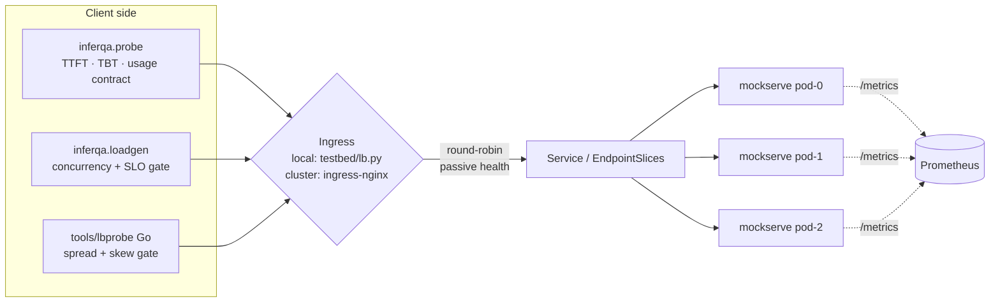

# inference-platform-qa

A test harness for the **deployment path** of an OpenAI-compatible inference service: client → ingress (NGINX) → Service → pods.
It doesn't test the model. It tests the platform around it: streaming through proxies, load balancing, service discovery, readiness, rolling deploys, and failover.
Those are the parts that break when you run inference at scale, and the model team usually isn't the first to see them.

The same assertions run on two layers:

- **Local testbed**: no Docker. Three real replica processes sit behind a proxy that copies NGINX upstream behaviour. Runs in about 15 seconds.
- **Cluster**: kind with real ingress-nginx and the production manifests. The same tests run against EKS/staging if you point `INGRESS_URL` at it.



## What's covered

| Layer | Property | Test |
|---|---|---|
| API contract | SSE framing: role chunk, finish chunk, usage chunk with `choices: []`, `[DONE]` | `test_stream_wire_format` |
| API contract | `usage.completion_tokens` matches the chunks actually streamed (a billing-gap check) | `test_sdk_stream_and_usage_agree` |
| API contract | `finish_reason=length` gets flagged, a missing usage chunk gets flagged, 404/400 errors map to the correct SDK exception | `test_contract.py` |
| Retry | 429s are retried with jittered backoff and `MAX_ATTEMPTS` is honoured (counted on the server) | `test_429_retried_then_raised` |
| Load balancing | Even round-robin spread across replicas | `test_round_robin_spreads_evenly`, `lbprobe -max-skew` |
| Streaming | The proxy doesn't buffer SSE, so TTFT stays well below total time | `test_sse_is_not_buffered`, `test_ingress_does_not_buffer_sse` |
| Failover | A killed pod gets no traffic, and connection-refused errors never reach the client | `test_killed_replica_gets_no_traffic` |
| Failover | An ejected peer comes back after `fail_timeout` | `test_ejected_replica_returns_after_fail_timeout` |
| Safety | A POST that reached a pod is **not** replayed after the pod dies mid-stream, so nothing is billed twice | `test_midstream_failure_is_not_replayed` |
| Lifecycle | SIGTERM: readiness drops to 503, the in-flight stream finishes, and the process exits 0 | `test_sigterm_drains_inflight_stream` |
| Lifecycle | Not-ready ≠ not-live: a pod leaves rotation but isn't restarted | `test_not_ready_replica_refuses_admin_toggle` |
| Discovery (k8s) | EndpointSlices match exactly the Ready pods | `test_endpoints_match_ready_pods` |
| Discovery (k8s) | A pod that fails `/readyz` leaves the EndpointSlices and stops receiving traffic | `test_not_ready_pod_leaves_rotation` |
| Chaos (k8s) | SIGKILL one pod under load and stay within a 2% error budget | `test_pod_kill_under_load_stays_within_error_budget` |
| Release (k8s) | `rollout restart` under load with **zero** failed requests | `test_rolling_restart_is_zero_error` |
| Performance | p50/p99 TTFT, TBT, output tok/s, error rate, and replica count are gated by `slo/default.json` | `test_load_meets_slo`, `inferqa.loadgen` |

## Failure design

These are failures I've seen in production inference stacks, and the config that prevents each one:

| What goes wrong | Prevention | Proven by |
|---|---|---|
| The UI freezes and then dumps the whole answer at once | `proxy-buffering: off` + `X-Accel-Buffering: no` | SSE buffering tests |
| Long generations get cut at 60s | `proxy-read-timeout: 300` | ingress annotation (review in PR) |
| A rolling deploy drops streams | `maxUnavailable: 0`, `preStop` sleep, SIGTERM drain in the server | `test_rolling_restart_is_zero_error`, `test_sigterm_drains_inflight_stream` |
| Traffic reaches a pod before Endpoints update | 5s `preStop` covers the gap between Endpoints removal and SIGTERM | rolling-restart test |
| A retry storm double-bills customers | `proxy-next-upstream: error timeout` only, with no `non_idempotent` | `test_midstream_failure_is_not_replayed` |
| A node drain takes out capacity | PDB `minAvailable: 2` + topology spread | manifests |
| A failed CI run with no clues | `scripts/collect_diagnostics.sh` dumps pods, EndpointSlices, ingress logs, and events as artifacts | CI `if: failure()` |

## Run it

```bash
make venv && make test          # 42 tests: unit + local-testbed integration (~15s)
make go                         # Go lbprobe vet + tests
make smoke                      # testbed up → probe → Go spread gate → load + SLO gate
make kind && make cluster-test  # needs docker, kind, kubectl
```

The same probe works against a real endpoint:

```bash
CEREBRAS_API_KEY=... python -m inferqa.probe --base-url https://api.cerebras.ai/v1 --model llama3.1-8b "hello"
```

## Layout

```
mockserve/        OpenAI-compatible replica: SSE, usage chunk, probes, /metrics, SIGTERM drain, fault injection
testbed/lb.py     L7 proxy that copies NGINX upstream semantics (RR, max_fails/fail_timeout, next_upstream)
inferqa/          probe (one stream + contract checks), loadgen (concurrency + SLO gate), metrics (pure math)
tools/lbprobe/    Go load-spread probe: replica skew, status mix, p50/p99; exit 1 gates a stage
tests/            unit/ · integration/ (local testbed) · cluster/ (kind / EKS)
deploy/           kustomize base + kind overlay, kind config, ArgoCD Application
.github/ Jenkinsfile   same pipeline in both: testbed → smoke → kind cluster → diagnostics on failure
docs/TEST_PLAN.md release validation strategy
```

## Where this stops

- The mock replica covers **platform** behaviour only. It says nothing about model quality, KV-cache pressure, or hardware-specific latency. On real hardware, swap the image and tighten `slo/` per model.
- `testbed/lb.py` copies only the NGINX behaviour the tests assert on. Anything that depends on real ingress behaviour has a `cluster` test.
- The cluster tests run in the CI kind job. They need Docker, kind, and kubectl, and they're skipped locally when `kubectl` is missing.
